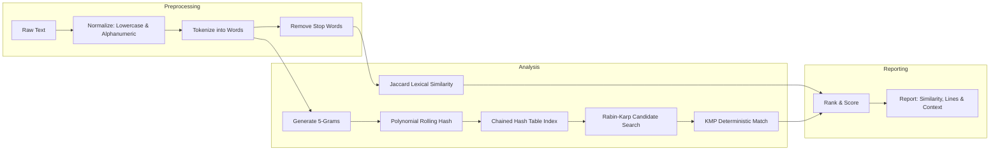
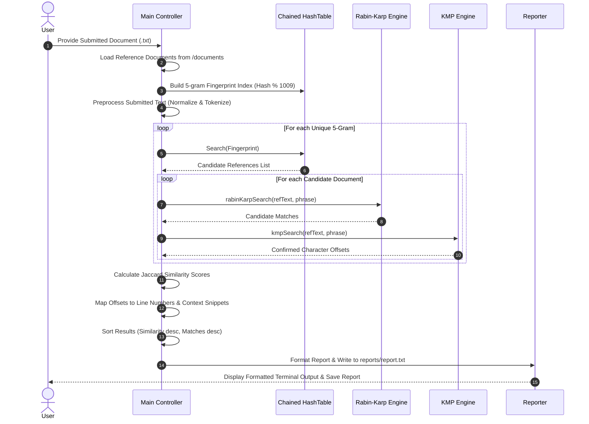

# Project Report: Algorithmic Plagiarism Detection System

**Author**: Project Engineering Team  
**Subject**: Data Structures & Algorithms / Text Processing  
**Project Scope**: Multi-Platform Implementation (C, C++, and Python)  

---

## 1. Problem Statement

With the rapid expansion of digital information, online academic resources, and open-access publishing, the integrity of written content has become increasingly critical. Plagiarism—ranging from verbatim copying and uncredited quotation to structural paraphrasing—poses significant ethical and academic challenges in universities, research institutions, and software development teams.

Manual verification of submissions against large document archives is computationally intractable for human evaluators. From an algorithmic standpoint, automated text comparison faces several fundamental hurdles:

1. **Computational Inefficiency of Naive Search**: Directly comparing a submitted document of length $N$ against $D$ reference documents of average length $M$ using naive string matching requires $\mathcal{O}(D \times N \times M)$ operations, making large-scale searches unacceptably slow.
2. **Noise and High False Positive Rates**: Natural languages heavily rely on common function words (*stop words* such as "the", "is", "in", "and"). Raw token overlap often falsely flags common grammatical constructions as plagiarized content.
3. **Hash Collisions & False Accusations**: Fast single-pass hashing methods risk false positives due to bucket collisions unless verified with deterministic exact-match algorithms.
4. **Lack of Traceability**: Many similarity algorithms output an opaque aggregate percentage score without identifying *where* the plagiarized sections occur in both the submitted and source texts.

To resolve these challenges, an algorithmic system must integrate sub-linear indexing, noise removal, dual-stage string verification, and exact line-level traceability.

---

## 2. Project Objectives

The primary objective of this project is to design, implement, and validate an end-to-end **Algorithmic Plagiarism Detection System** across C, C++, and Python that combines fast candidate filtering with deterministic verification.

### Specific Technical Objectives
- **Multi-Stage Verification Pipeline**: Implement a fast candidate-filtering layer using custom separate-chaining hash tables, verified by polynomial rolling hash search (Rabin-Karp) and deterministic prefix-function search (Knuth-Morris-Pratt).
- **Lexical and Structural Similarity**: Measure both vocabulary-level overlap using Jaccard Similarity and contiguous phrase replication using 5-gram fingerprinting.
- **Noise Elimination**: Design a text normalization and stop-word filtering routine that retains structural alignment while removing linguistic noise.
- **Traceable Localization**: Pinpoint the exact line numbers and context snippets in both the submitted document and candidate reference documents.
- **Cross-Language Consistency**: Ensure mathematical and algorithmic parity across C, C++, and Python so identical inputs yield identical rankings and percentages.

---

## 3. Theoretical Concepts & Core Algorithms



### 3.1. Text Normalization & Invariant Mapping
Text normalization standardizes raw documents to eliminate differences caused by case sensitivity, punctuation, and extraneous formatting.
- **Alphanumeric Filter**: Non-alphanumeric characters (punctuation, symbols) are converted to spaces.
- **Case Normalization**: All alphabetical characters are transformed to lowercase via $\text{tolower}(c)$.
- **1-to-1 Index Invariant**: In our normalization routine, each input character is replaced with exactly one output character. This invariant ensures that:
  $$\text{length}(\text{normalized\_text}) = \text{length}(\text{original\_text})$$
  Any match index found in the normalized text directly corresponds to the exact byte offset in the original document, enabling $\mathcal{O}(1)$ back-mapping to line numbers.

### 3.2. Stop-Word Removal
Natural languages feature high-frequency grammatical words that carry minimal topical information. The system filters 25 common English stop words:
$$\mathcal{S}_{\text{stop}} = \{\text{"the", "is", "are", "a", "an", "and", "of", "in", "to", "for", "on", "with", "by", "it", "this", "that", "was", "were", "be", "as", "at", "from", "or", "has", "have"}\}$$
Removing $\mathcal{S}_{\text{stop}}$ isolates domain-specific terminology before calculating the Jaccard similarity score.

### 3.3. $N$-Gram Fingerprinting
An $N$-gram is a contiguous sequence of $N$ tokens extracted from a text sequence $W = [w_1, w_2, \dots, w_k]$. For $N = 5$:
$$\text{NGram}_i = (w_i, w_{i+1}, w_{i+2}, w_{i+3}, w_{i+4}) \quad \text{for } 0 \le i \le k - 5$$
Five words represent a standard linguistic threshold where identical contiguous sequences strongly indicate copied text rather than coincidental phrasing.

### 3.4. Custom Chained Hash Table
To avoid dependencies on external database engines or built-in dictionary implementations, the system implements a custom separate-chaining Hash Table:
- **Bucket Capacity**: Fixed prime sizes ($M = 101$ for pairwise checks, $M = 1009$ for reference corpora).
- **Hash Function**:
  $$h(k) = k \pmod M$$
- **Separate Chaining**: Each bucket stores a linked list (or dynamic bucket array) of `HashEntry(key, document_name)` nodes, guaranteeing $\mathcal{O}(1)$ average insertion and search time.

### 3.5. Polynomial Rolling Hash & Rabin-Karp Algorithm
The Rabin-Karp algorithm hashes strings into numeric values to check for pattern occurrences in linear average time.
- **Polynomial Hash Formula**: For a pattern $P$ of length $m$ over an alphabet of radix $B = 256$ with prime modulo $Q = 10^9 + 7$:
  $$H(P) = \left( \sum_{i=0}^{m-1} P[i] \cdot B^{m - 1 - i} \right) \pmod Q$$
- **Rolling Transition**: When shifting the sliding window from index $i$ to $i+1$ in text $T$:
  $$H(T[i+1 \dots i+m]) = \left( \left( H(T[i \dots i+m-1]) - T[i] \cdot B^{m-1} \right) \cdot B + T[i+m] \right) \pmod Q$$
- **Collision Verification**: If $H(T_{\text{window}}) = H(P)$, the substring is verified character-by-character to prevent false positives from modular arithmetic collisions.

### 3.6. Knuth-Morris-Pratt (KMP) Verification
To eliminate single-algorithm dependency and false matches, candidates identified by Rabin-Karp undergo independent verification using the KMP algorithm:
- **Longest Prefix Suffix (LPS) Array**: Precomputes an array $\pi$ of length $m$ where $\pi[j]$ stores the length of the longest proper prefix of $P[0 \dots j]$ that is also a suffix of $P[0 \dots j]$.
- **Backtrack-Free Search**: When a mismatch occurs between $T[i]$ and $P[j]$, the search pointer $j$ resets to $\pi[j - 1]$ rather than resetting $i$, guaranteeing strict $\mathcal{O}(|T| + |P|)$ worst-case time complexity.

### 3.7. Jaccard Similarity Coefficient
To evaluate overall thematic and lexical overlap beyond literal substrings, the system computes the Jaccard Similarity Index over the sets of stop-word-free words $A$ and $B$:
$$J(A, B) = \frac{|A \cap B|}{|A \cup B|} \times 100\% = \frac{|A \cap B|}{|A| + |B| - |A \cap B|} \times 100\%$$
- $J(A, B) = 0\%$: Complete lexical independence.
- $J(A, B) = 100\%$: Identical vocabulary profile.

---

## 4. System Architecture & Workflow



### Execution Pipeline Stages:
1. **Corpus Ingestion**: The system iterates through `documents/*.txt`, reads each file, normalizes character representations, and computes line starting offsets.
2. **Index Construction**: 5-grams are extracted from each reference file, hashed using the 64-bit polynomial function, and mapped into the `HashTable`.
3. **Query Ingestion**: The target submission file is read, normalized, tokenized, and partitioned into unique 5-grams.
4. **Candidate Retrieval & Verification**:
   - For each 5-gram, the `HashTable` returns candidate documents that contain the identical fingerprint.
   - The candidate text is scanned with `RabinKarpSearch`.
   - The match is confirmed using `KMPSearch`.
5. **Localization & Reporting**:
   - Character offsets are translated to 1-indexed line numbers using binary search over line break boundaries.
   - The Jaccard similarity percentage is calculated.
   - Results are ranked and exported to `reports/report.txt`.

---

## 5. Output Explanation & Experimental Results

### Sample Test Case
- **Submitted File**: `ds/input/submission.txt` (Article covering Artificial Intelligence, Supervised/Unsupervised Learning, and Neural Networks)
- **Reference Corpus**: 6 distinct reference documents (`reference1.txt` through `reference6.txt`)

### Terminal & Report Output Breakdown
```text
========================================
       PLAGIARISM DETECTION SYSTEM
========================================

Loading reference documents...
6 reference document(s) loaded.

Building reference fingerprint index...
Comparing documents...

========== PLAGIARISM DETECTION REPORT ==========

Rank: 1
Reference: ds\documents\reference3.txt
Similarity: 19.32%
Matching passages: 3
  Matching text: "neural networks and deep learning"
    -> In submitted document : Line 40, Line 68
    -> In reference document : Line 16
       Snippet (Submission): "4. Neural Networks and Deep Learning"
  Matching text: "of computer science concerned with"
    -> In submitted document : Line 3
    -> In reference document : Line 28
       Snippet (Submission): "Artificial Intelligence (AI) is a field of computer science concerned with developing machines and software capable o..."
  Matching text: "of artificial intelligence that enables"
    -> In submitted document : Line 8
    -> In reference document : Line 16
       Snippet (Submission): "Machine Learning (ML) is a specialised area of artificial intelligence that enables computer systems to learn from da..."

Rank: 2
Reference: ds\documents\reference2.txt
Similarity: 17.69%
Matching passages: 0

Rank: 3
Reference: ds\documents\reference1.txt
Similarity: 17.42%
Matching passages: 0

Rank: 4
Reference: ds\documents\reference4.txt
Similarity: 14.41%
Matching passages: 0

Rank: 5
Reference: ds\documents\reference6.txt
Similarity: 12.46%
Matching passages: 0

Rank: 6
Reference: ds\documents\reference5.txt
Similarity: 7.92%
Matching passages: 0

Report saved to ds\reports\report.txt

Note: Similarity is an indicator, not proof of plagiarism.

Analysis completed successfully.
```

### Interpretation of Results:
1. **Rank 1 (`reference3.txt`)**: 
   - Exhibited the highest combined similarity (**19.32%**) and **3 verified verbatim 5-grams**.
   - Line numbers pinpoint the copied passages:
     - *"neural networks and deep learning"* appeared at Lines 40 and 68 in `submission.txt` and Line 16 in `reference3.txt`.
     - *"of computer science concerned with"* appeared at Line 3 in `submission.txt` and Line 28 in `reference3.txt`.
     - *"of artificial intelligence that enables"* appeared at Line 8 in `submission.txt` and Line 16 in `reference3.txt`.
2. **Ranks 2–6 (`reference2.txt`, `reference1.txt`, etc.)**:
   - Exhibited moderate Jaccard similarity (7.92% – 17.69%) due to common machine learning vocabulary (e.g., "data", "model", "training", "algorithm").
   - However, they recorded **0 matching passages**, proving that the dual Rabin-Karp/KMP verification correctly rejected documents without verbatim text replication.

---

## 6. Algorithmic Complexity Analysis

| Component | Average Time Complexity | Worst-Case Time Complexity | Space Complexity |
| :--- | :--- | :--- | :--- |
| Text Normalization | $\mathcal{O}(N)$ | $\mathcal{O}(N)$ | $\mathcal{O}(N)$ |
| Stop-Word Filtering | $\mathcal{O}(W)$ | $\mathcal{O}(W)$ | $\mathcal{O}(W)$ |
| Hash Table Indexing | $\mathcal{O}(K)$ | $\mathcal{O}(K^2)$ (degenerate) | $\mathcal{O}(K)$ |
| Rabin-Karp Search | $\mathcal{O}(N + M)$ | $\mathcal{O}(N \times M)$ | $\mathcal{O}(1)$ |
| KMP Search | $\mathcal{O}(N + M)$ | $\mathcal{O}(N + M)$ | $\mathcal{O}(M)$ |
| Line Offset Mapping | $\mathcal{O}(\log L)$ | $\mathcal{O}(\log L)$ | $\mathcal{O}(L)$ |
| Overall Document Comparison | $\mathcal{O}(D \cdot (N + M))$ | $\mathcal{O}(D \cdot (N + M))$ | $\mathcal{O}(\text{Corpus Tokens})$ |

*Where $N = |T|$, $M = |P|$, $W = \text{word count}$, $K = \text{number of } N\text{-grams}$, $L = \text{line count}$, and $D = \text{document count}$.*

---

## 7. Conclusion

The Algorithmic Plagiarism Detection System establishes an efficient, deterministic, multi-stage architecture for document verification:
- **High Sensitivity & Precision**: Combining lexical Jaccard index with exact 5-gram dual string matching prevents false positives while flagging verbatim copying.
- **Traceability**: 1-to-1 normalized offset mapping resolves the exact line numbers and context snippets in both the submission and reference texts.
- **Cross-Language Consistency**: The logic operates consistently across low-level C, modern C++, and Python.

---

## 8. Future Enhancements & Real-World Applications

### 8.1. Planned Algorithmic Enhancements
1. **Semantic Embeddings & Paraphrase Detection**:
   - Integrate transformer-based sentence embeddings (e.g., Sentence-BERT) to compute cosine similarity on dense vectors. This will catch paraphrased content where synonym replacement evades literal 5-gram matching.
2. **Winnowing Algorithm & MinHash LSH**:
   - For corpus sizes exceeding $10^5$ documents, full 5-gram hashing can be compressed using the **Winnowing algorithm** to select local fingerprint minima and **Locality-Sensitive Hashing (MinHash LSH)** for sub-linear nearest-neighbor lookup.
3. **Abstract Syntax Tree (AST) Analysis for Source Code**:
   - Extend the engine to programming languages (C, C++, Python, Java) by compiling source files into ASTs to detect renamed variables, reordered functions, and refactored logic.
4. **File Format Support**:
   - Integrate parsers for PDF, DOCX, and LaTeX documents with automatic bibliography and citation extraction.

### 8.2. Real-World Applications
- **Academic Institutions**: Automated assessment and screening of undergraduate assignments, theses, and research papers.
- **Peer-Review Publishing**: Pre-screening journal submissions against repository preprints (arXiv, bioRxiv).
- **Corporate Content Moderation**: Verifying originality in technical documentation, blog publishing, and marketing copy.
- **Legal & Intellectual Property**: Identifying unauthorized reproduction of proprietary text or contractual terms.
